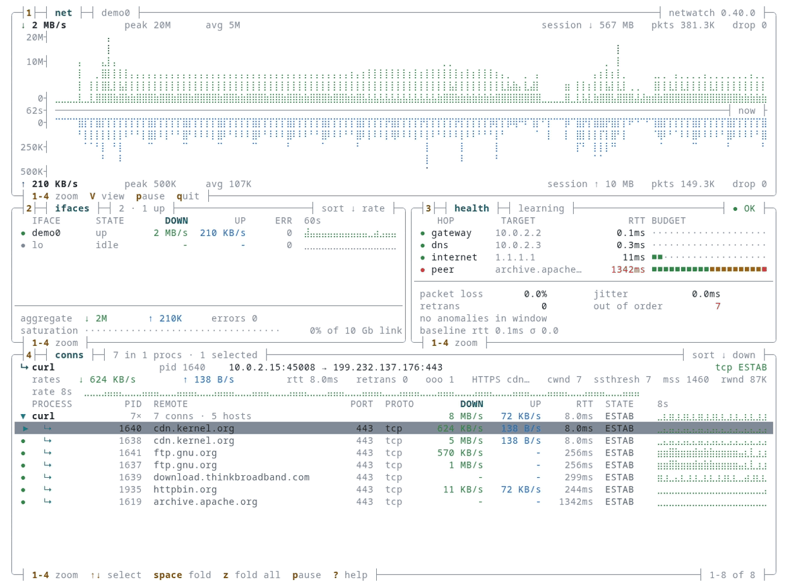

  <a href="https://www.netwatchlabs.com">
    <picture>
      <source media="(prefers-color-scheme: dark)" srcset="assets/terrain-dark.svg">
      <source media="(prefers-color-scheme: light)" srcset="assets/terrain-light.svg">
      
    </picture>
  </a>

I build Rust tools for investigating networks, hosts, disks and the Linux kernel.
My focus is making system behaviour easier to inspect from the terminal.

Sydney, Australia · [NetWatch Labs](https://netwatchlabs.com) · [LinkedIn](https://www.linkedin.com/in/matt-hartley-b5b28b40/)

## Start with netwatch

[**netwatch**](https://github.com/matthart1983/netwatch) brings network traffic, connections and process activity into one terminal. It is packaged in Homebrew, conda-forge, nixpkgs, the AUR and Scoop, and was [Terminal Trove's Tool of the Week](https://terminaltrove.com/blog/terminal-trove-april-2026-wrap-up/) in April 2026.

<b><a href="https://github.com/matthart1983/netwatch#install">Install netwatch</a></b> · <a href="https://github.com/matthart1983/netwatch#run">Run and explore</a>

  <a href="https://github.com/matthart1983/netwatch#readme">
    <picture>
      <source media="(prefers-color-scheme: dark)" srcset="assets/netwatch.png">
      <source media="(prefers-color-scheme: light)" srcset="assets/netwatch-light.png">
      
    </picture>
  </a>

<em>Demo traffic in the dense view: throughput above, interfaces and hop latency in the middle, connections below. Click to watch it run.</em>

## Choose a diagnostics tool

Start with the part of the system you need to investigate. netwatch, syswatch and diskwatch share a terminal layout and palette.

| Tool | What to use it for |
|---|---|
| [**netwatch**](https://github.com/matthart1983/netwatch) | Inspect traffic, connections and network behaviour. |
| [**syswatch**](https://github.com/matthart1983/syswatch) | Investigate resource use and revisit recent system activity. |
| [**diskwatch**](https://github.com/matthart1983/diskwatch) | Inspect disk activity, capacity, health and busy files. |
| [**kernwatch**](https://github.com/matthart1983/kernwatch) | Investigate Linux scheduling, memory pressure and block I/O. |

## Engineering notes

- [**Process attribution: identity, freshness and coverage**](https://github.com/matthart1983/netwatch/blob/main/docs/attribution.md) — how netwatch checks ownership evidence, handles stale observations and reports what remains unknown.
- [**Designing netwatch's terminal views**](https://github.com/matthart1983/netwatch/blob/main/docs/DESIGN-0.30.md) — the version 0.30 design document covering layout, visual hierarchy and dense and lite views.

## Other selected work

- [**essh**](https://github.com/matthart1983/essh) — remote shells that survive connection drops, built on OpenSSH and tmux.
- [**nanofix**](https://github.com/matthart1983/nanofix) — a Rust FIX engine. NewOrderSingle serialisation benchmarked at 28.7× faster than QuickFIX/J on Apple Silicon; [results and methodology](https://github.com/matthart1983/nanofix/blob/main/BENCHMARKS.md).

[Browse all projects](https://github.com/matthart1983?tab=repositories).

## Get in touch

For netwatch questions and ideas, use [Discussions](https://github.com/matthart1983/netwatch/discussions).
For professional conversations, connect on [LinkedIn](https://www.linkedin.com/in/matt-hartley-b5b28b40/).

