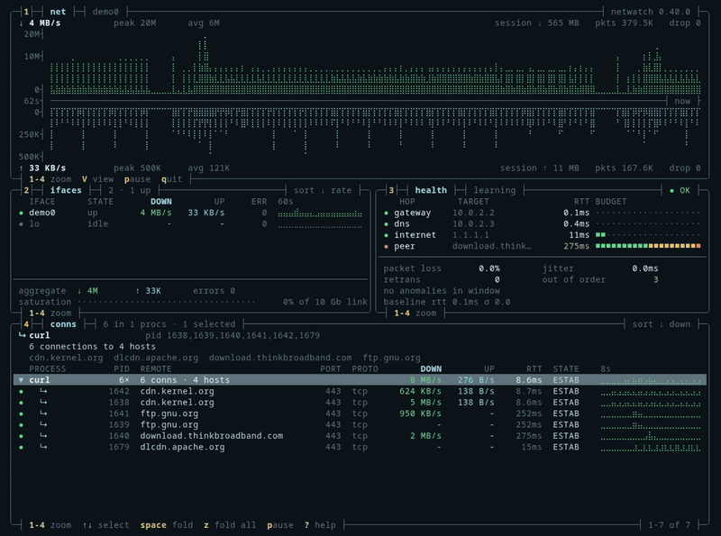

# Matt Hartley

Systems engineer building terminal diagnostics tools in Rust. Sydney, Australia.
[netwatchlabs.com](https://netwatchlabs.com)

  

<b><a href="https://github.com/matthart1983/netwatch#install">Install netwatch</a></b>

netwatch was [Terminal Trove's Tool of the Week](https://terminaltrove.com/netwatch/), was covered by [Habr](https://habr.com/en/news/1094358/) and was featured in Github Awesome's [35 Self-Hosted Projects on GitHub](https://www.youtube.com/watch?v=TBOtZ3mBktM&t=112s). It ships in Homebrew, conda-forge, nixpkgs, the AUR and Alpine (testing). Across the tools: 120k+ downloads (Nov 2026).

## Diagnostics tools

netwatch, syswatch and diskwatch share one layout and palette.

- **[netwatch](https://github.com/matthart1983/netwatch)**: live capture with L7 decode, TLS 1.3 decryption, eBPF process attribution on Linux and baseline-driven diagnosis. 
- **[syswatch](https://github.com/matthart1983/syswatch)**: CPU, memory, disks, processes, GPU and power on macOS and Linux, with recent history you can scrub. 
- **[diskwatch](https://github.com/matthart1983/diskwatch)**: disk activity, capacity, health and busy files in one terminal. Read-only, no config. 
- **[kernwatch](https://github.com/matthart1983/kernwatch)**: CPU contention, scheduling, memory pressure and block IO on Linux, with stack profiles and incident reports. 
- **[essh](https://github.com/matthart1983/essh)**: remote shells that survive connection drops, built on OpenSSH and tmux. 
- **[netscan](https://github.com/matthart1983/netscan)**: an nmap workflow with target inventory, saved profiles, live results and scan diffs. *Paused.* 

## Low-latency work

- **[nanofix](https://github.com/matthart1983/nanofix)**: a zero-allocation FIX engine, benchmarked on Apple Silicon at 29× faster serialisation than QuickFIX/J ([methodology](https://github.com/matthart1983/nanofix/blob/main/BENCHMARKS.md)).
- **[ticktape](https://github.com/matthart1983/ticktape)**: a framework for deterministic, replicated services on the sequencer architecture, with simulation testing built in. *Paused.*

## Also

[soundwatch](https://github.com/matthart1983/soundwatch): audio diagnostics for macOS and Linux ·
[agentwatch](https://github.com/matthart1983/agentwatch): run and watch AI agent workflows *(paused)* ·
[logwatch](https://github.com/matthart1983/logwatch): log templating and novel-pattern detection *(paused)*

`Rust` · `ratatui` · `tokio` · `eBPF` · `FIX` · `Aeron`

Paused: no commits in the last 90 days.
